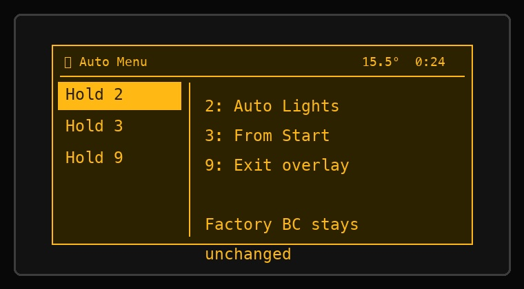

# Vectra C Auto Lights Module

Concept и firmware scaffold за low-wiring auto lights модул за Opel Vectra C / Signum с retrofit `AUTO` копче за фарове, CD30 MP3 и GID.

Целта е да се избегне вариантът с много окабеляване, при който custom модул директно захранва xenon ballasts, fog lamps или sidelights. По-безопасната архитектура е:

- заводските BCM/UEC/REC да продължат да управляват lamp power, diagnostics и protection;
- модулът да работи само когато factory light switch е на `AUTO`;
- когато е възможно, модулът да емулира валидни manual switch states;
- MS-CAN да се използва първо за read-only vehicle state и GID overlay;
- да се избягва директно окабеляване към D1S ballasts и lamp circuits, освен ако измерването не докаже, че няма по-чист вариант.

## Текущ статус

Това не е готов installable product.

Проектът съдържа:

- описани requirements и install plan;
- C++ state machine за light modes;
- Bluetooth phone app MVP план;
- C++ `From Start` trip logic;
- PlatformIO-style ESP32 firmware scaffold;
- host-side tests за core logic;
- GID overlay concept mockups.

Основната липсваща hardware информация е как точно Vectra C light switch кодира позициите си на тази конкретна кола.

## Целева кола

Известна конфигурация:

- Opel Vectra C, 2008;
- D1S/H1 headlights;
- CD30 MP3 + GID;
- retrofit headlight switch с `AUTO`;
- има rain sensor;
- light sensor не е потвърден;
- OP-COM DRL v3 в момента пуска low beams още на ignition в `AUTO`;
- manual sidelights/low beam позициите димират cluster и CD30/GID правилно;
- AUTO/DRL поведението не димира CD30/GID правилно.

## Желано поведение

| Mode | Condition | Lights |
|---|---|---|
| Welcome | unlock without key | configurable: off / sidelights / low beam / fog / safe combinations |
| IGN/ACC | ignition on, engine not running | configurable: off / sidelights / low beam / fog / safe combinations, default off |
| DRL | engine running | low beam xenon + front/rear sidelights |
| Goodbye | engine stops | configurable: off / sidelights / low beam / fog / safe combinations |

Важни изисквания:

- xenon не трябва да се включва само на ignition/ACC;
- xenon трябва да се включва веднага след engine-running detection, за да се вижда factory level test на тъмно;
- в `AUTO` модулът трябва да емулира manual low beam, вместо да разчита на OP-COM DRL v3;
- manual switch positions трябва да имат приоритет над модула.

## Текущ MVP фокус

Текущият фокус е:

- управление на фаровете в `AUTO`;
- правилно dimming/яркост поведение на CD30/GID чрез factory dimming;
- конфигурация през Bluetooth/BLE приложение от телефона;
- GID overlay и `From Start` остават future етап.

## GID посока

GID интеграцията вече не е първи фокус.

Предпочитаната future GID интеграция не е factory BC tab.

Реалистичната цел е GID overlay, подобно като идея на проекти като EHU32:

- long press на един CD30/BC бутон отваря `Auto Menu`;
- steering wheel buttons или radio controls движат менюто, ако CAN frames се потвърдят;
- модулът временно рисува собствен екран на GID;
- заводските `BC 1`, `BC 2` и `Timer` остават недокоснати.

Mockups:




## Документация

- [Режими](docs/modes-bg.md)
- [Bluetooth phone app MVP](docs/ble-phone-app-bg.md)
- [Guide за начинаещи](docs/beginner-guide-bg.md)
- [GID / Board Computer integration](docs/gid-bc-integration-bg.md)
- [Монтажен план и BOM](docs/install-and-bom-bg.md)
- [Изводи от repair guide](docs/repair-guide-findings-bg.md)
- [Чеклист за измерване](hardware/measurement-checklist-bg.md)
- [Бележки за преглед](docs/review-notes-bg.md)

## Firmware

Firmware-ът нарочно е разделен на hardware-independent logic и ESP32 integration placeholders.

Core files:

- `firmware/src/AutoLightsController.*`
- `firmware/src/FromStartTrip.*`
- `firmware/src/main.cpp`

Пускане на host-side tests:

```sh
cd firmware
make test
```

## Бележки за безопасност

Този проект е за investigation и prototype planning.

Преди да се монтира каквото и да е в колата:

- измери light switch connector във всички позиции;
- потвърди OP-COM поведението с `DRL disabled`;
- потвърди MS-CAN access и button frames в read-only режим;
- валидирай engine-running detection преди да се използва за управление на lights;
- използвай fused power и automotive input protection;
- проектирай outputs fail-safe, така че повреден модул да не може да остави xenon включен или да счупи manual light control.

В първия design не захранвай директно D1S ballasts от този модул.
