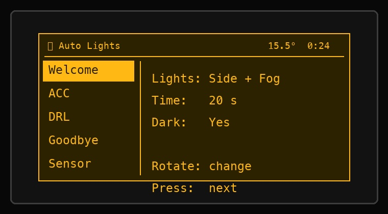
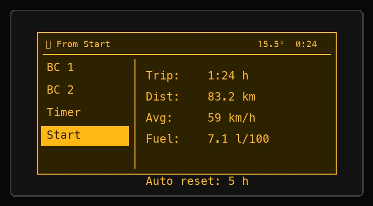

# Vectra C Auto Lights Module

Concept and firmware scaffold for a low-wiring auto lights module for Opel Vectra C / Signum with retrofit `AUTO` light switch, CD30 MP3 and GID.

The goal is to avoid the heavy wiring approach where a custom module directly powers xenon ballasts, fog lamps or sidelights. The safer target architecture is:

- keep the factory BCM/UEC/REC in charge of lamp power, diagnostics and protection;
- operate only when the factory light switch is in `AUTO`;
- emulate valid manual switch states where possible;
- use MS-CAN primarily for read-only vehicle state and GID overlay;
- avoid direct wiring to D1S ballasts and lamp circuits unless measurement proves there is no cleaner option.

## Current Status

This is not a finished installable product.

It contains:

- documented requirements and install plan;
- C++ state machine for the light modes;
- C++ `From Start` trip logic;
- PlatformIO-style ESP32 firmware scaffold;
- host-side tests for the core logic;
- GID overlay concept mockups.

The main missing hardware fact is how the Vectra C light switch encodes its positions on this exact car.

## Target Car

Known target configuration:

- Opel Vectra C, 2008;
- D1S/H1 headlights;
- CD30 MP3 + GID;
- retrofit headlight switch with `AUTO`;
- rain sensor present;
- light sensor not confirmed;
- OP-COM DRL v3 currently turns low beams on at ignition in `AUTO`;
- manual sidelights/low beam positions dim the cluster and CD30/GID correctly;
- AUTO/DRL behavior does not dim CD30/GID correctly.

## Desired Behavior

| Mode | Condition | Lights |
|---|---|---|
| Welcome | unlock without key | configurable: off / sidelights / low beam / fog / safe combinations |
| ACC | ignition on, engine not running | configurable, default off or sidelights only |
| DRL | engine running | low beam xenon + front/rear sidelights |
| Goodbye | engine stops | configurable: off / sidelights / low beam / fog / safe combinations |

Important requirements:

- xenon must not turn on at ignition-only/ACC;
- xenon should turn on right after engine-running detection so the factory level test is visible in the dark;
- in `AUTO`, the module should emulate manual low beam rather than relying on OP-COM DRL v3;
- manual switch positions must override the module.

## GID Direction

The preferred GID integration is not a factory BC tab at first.

The realistic target is a GID overlay, similar in principle to projects such as EHU32:

- long press one CD30/BC button to open `Auto Menu`;
- steering wheel buttons or radio controls navigate the menu, if their CAN frames are confirmed;
- the module temporarily writes its own screen to GID;
- factory `BC 1`, `BC 2` and `Timer` remain untouched.

Mockups:






## Documentation

- [Modes](docs/modes-bg.md)
- [GID / Board Computer integration](docs/gid-bc-integration-bg.md)
- [Install plan and BOM](docs/install-and-bom-bg.md)
- [Repair guide findings](docs/repair-guide-findings-bg.md)
- [Measurement checklist](hardware/measurement-checklist-bg.md)

## Firmware

The firmware is intentionally split into hardware-independent logic and ESP32 integration placeholders.

Core files:

- `firmware/src/AutoLightsController.*`
- `firmware/src/FromStartTrip.*`
- `firmware/src/main.cpp`

Run host-side tests:

```sh
cd firmware
make test
```

## Safety Notes

This project is for investigation and prototype planning.

Before installing anything in the car:

- measure the light switch connector in all positions;
- confirm OP-COM behavior with `DRL disabled`;
- confirm MS-CAN access and button frames in read-only mode;
- validate engine-running detection before using it to command lights;
- use fused power and automotive input protection;
- design outputs fail-safe so a dead module cannot leave xenon on or break manual light control.

Do not directly power D1S ballasts from this module in the first design.
